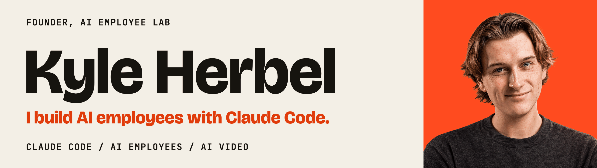

# Kyle Herbel

**I build AI employees with Claude Code, and I teach people who have never coded to build their own.**

Founder of [AI Employee Lab](https://www.skool.com/aiemployeelab) and [CortexTools](https://cortextools.ai), based in Orange County, California. I spent 7+ years in ecom, trading and consulting before going all-in on AI. Now I'm building my own AI team in public and sharing the templates as I go.

## Start here

- 🧪 **[AI Employee Lab](https://www.skool.com/aiemployeelab)**: Learn to build AI employees that run your business, alongside 1,200+ members. 15 templates, 13 courses, no coding needed. $9/month, cancel anytime.
- 🎬 **[YouTube](https://www.youtube.com/@kyleherbel)**: Claude Code, Codex and AI video tutorials, including full courses.
- 🧠 **[CortexTools](https://cortextools.ai)**: The AI learning company. Helping everyday people build real things with AI.

## Free tools

- 🪪 **[Identity Studio](https://github.com/silentobelisk/identity-studio)**: Give your AI employee a name, a face and a point of view, then download the whole kit. Runs locally, no API key, MIT licensed.
- 🖥️ **[Agentic OS](https://silentobelisk.github.io/agentic-os/)**: Local desktop console for Claude Code. Track plan usage, run your skills, map your second brain as a knowledge graph, and work in a live terminal.
- 🔧 **[HelpClaw](https://github.com/silentobelisk/helpclaw)**: OpenClaw troubleshooting assistant. Clone it, open Claude Code, Codex or Copilot, and describe the problem.

## What's an AI employee?

An AI employee has a name, a job description, a memory you can open and read, duties that run on a schedule, and guardrails. It runs on your machine and you text it like a coworker over iMessage, Discord or Telegram. It is not a one-off ChatGPT prompt or a Zapier workflow.

The honest version: guard hooks are pattern matchers, not security boundaries, and your data still goes to Anthropic's API. Know that before you hand one your inbox.

## What I build and teach

- **AI employees for real jobs:** editing videos, finding leads, creating content.
- **Claude Code skills and plugins:** reusable skill files that give an AI employee its duties.
- **AI video:** raw footage to polished edits, plus motion graphics with Claude Code, Remotion and HyperFrames.
- **Lead lists and outreach:** building prospect lists and running automated outreach.
- **Second brains:** Obsidian notes and knowledge graphs as long-term memory.
- **Selling AI employees:** building them for clients as a service.

## Latest videos

<!-- VIDEOS:START -->
- [Seedance 2.5 + Claude = Motion Graphics In 10 Minutes](https://www.youtube.com/watch?v=C2as3M4P9dA)
- [I Made Vox Style Motion Graphics With 1 Prompt (Claude Code)](https://www.youtube.com/watch?v=StFCNZ9shSA)
- [I Built an App Without Touching My Keyboard (ChatGPT + Codex)](https://www.youtube.com/watch?v=q1gdSfcBFh8)
- [I Tested Claude Opus 5 (The Numbers Are INSANE)](https://www.youtube.com/watch?v=10TH2J8ejF0)
- [Claude Code + ADHD Skill = 10x More Creative AI Agents](https://www.youtube.com/watch?v=O1vceGWkD9c)
<!-- VIDEOS:END -->

## Connect

> "I believe AI's real promise isn't replacing humans — it's giving them their time back so they can think, love, play, and feel fulfilled."
